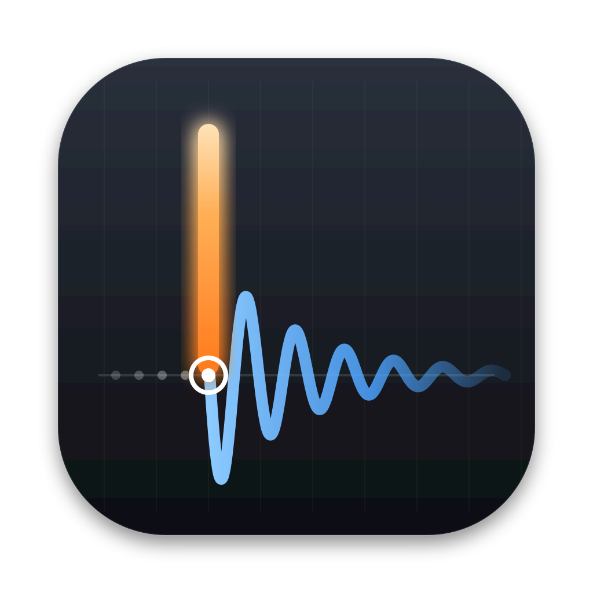

<p align="center">
  
</p>

<h1 align="center">Drum Spike</h1>

<p align="center">
  Sample-exact drum hits from your multitrack recording, as MIDI and spike files for your DAW.
</p>

<p align="center">
  <a href="https://github.com/Cherry-Blossom-Valley/drumspike/releases/latest"></a>
  <a href="https://github.com/Cherry-Blossom-Valley/drumspike/actions/workflows/ci.yml"></a>
  <a href="LICENSE"></a>
  
</p>

<p align="center">
  <a href="https://cherry-blossom-valley.com/tools/drum-spike/">Website</a> ·
  <a href="https://github.com/Cherry-Blossom-Valley/drumspike/releases/latest">Download</a> ·
  <a href="docs/guide/README.md">User guide</a> ·
  <a href="CONTRIBUTING.md">Contributing</a>
</p>


Drum Spike is a Mac app for mixing engineers. It finds the drum hits in the close-mic tracks of a
recorded session and moves each hit to the first sample of its attack. You check and edit the hits
in a DAW-style spike editor. Then you export a MIDI file and a spike track per drum track. Because
every hit is sample-exact, a trigger plug-in or a sample replacer fires on the right sample.

Drum Spike is free and open source (Apache-2.0).

## Features

- **Bring in a session.** Add the audio files of a Pro Tools, Cubase or other session. The files
  are referenced in place, with their BWF time stamps; the track roles come from the names or the
  audio.
- **Detection per role.** A spectral onset detector finds the hits, and each track keeps the hits
  of its own drum: a snare mic yields snare hits.
- **Sample-exact placement.** Each hit moves to the first motion of its attack.
- **Velocity.** How hard each hit was played, from its attack level, shaped in the velocity lane.
- **Check and fix.** Play, zoom and jump from hit to hit like in a DAW; add, delete or move hits,
  with undo for every edit. A review queue shows the least certain hits first.
- **Bleed and hard cases.** The snare in the tom mic and the kick in the snare mic are recognised
  and cleaned; flams and rolls are split.
- **Learn.** Mark an unwanted pattern and every similar hit goes; show a missed hit and similar
  ones come back.
- **Followers, layers, tempo.** A sub mic follows the kick; a layer plays your own one-shot at
  every hit; a detected tempo map, bar and beat grid, and whole-number tempos.
- **Export.** MIDI and spike WAV files that land at the session position in your DAW, with the
  tempo map in the MIDI file.
- **Automate it.** Every app operation is also a command for a script or an AI agent
  ([agent API](docs/agent-api.md)), and detectors are plug-ins
  ([guide](docs/guide/03b-detector-plugins.md)).

## Download and install

Download the `.dmg` for your Mac from the
[latest release](https://github.com/Cherry-Blossom-Valley/drumspike/releases/latest):

| Your Mac | File |
|---|---|
| Apple silicon (M1 and newer) | `Drum-Spike_<version>_aarch64.dmg` |
| Intel | `Drum-Spike_<version>_x86_64.dmg` |

Open the `.dmg`, drag Drum Spike to Applications, and start it. Both files are signed with a
Developer ID and notarized by Apple. Check a download with `shasum -a 256 -c SHA256SUMS`.

Then read the [user guide](docs/guide/README.md): it walks from adding tracks to the export in
fourteen short chapters, and [Get the best results](docs/guide/best-results.md) collects the tips.

## Build from source

You need an Apple Silicon Mac with the Xcode command line tools, Rust through
[rustup](https://rustup.rs), [uv](https://docs.astral.sh/uv/) and Node 22.

```bash
git clone https://github.com/Cherry-Blossom-Valley/drumspike
cd drumspike
(cd apps/desktop && npm ci && npx tauri build --debug --target aarch64-apple-darwin --bundles app)
open "target/aarch64-apple-darwin/debug/bundle/macos/Drum Spike.app"
```

Run the tests:

```bash
uv sync && uv run playwright install chromium
cargo build --release -p drumspike-devtools && cargo build -p drumspike-devtools --bin ds-bridge
cargo test --workspace
DRUMSPIKE_AUDIO=null DRUMSPIKE_REQUIRE_APP=1 DRUMSPIKE_REQUIRE_CORE=1 uv run pytest -q
```

The [developer guide](docs/DEVELOPING.md) covers the architecture, the test gates, CI and the
release build; [RELEASING.md](docs/RELEASING.md) covers signing and notarization.

## How it works

The Rust core (`crates/core`) runs these steps per track; the app (`crates/app`) runs them as a job:

1. Decode the audio file to mono float32 at its native sample rate (44.1, 48 or 96 kHz).
2. Detect the hits with the DSP onset detector (a log-filtered spectrogram and peak picking).
3. Keep the hits that match the track's role (kick, snare, tom, hat, cymbal, other), and remove
   bleed from other drums.
4. Move each hit to the acoustic attack, sample-exact.
5. Map the attack levels to MIDI velocities.

A 10-minute 48 kHz track takes about 2 s on an M2 Pro. The editor (`static/`) draws the waveform
and spike lanes with WebGL2 inside a Tauri 2 window; the app has no server and no Python.

## Repository

| Path | Content |
|---|---|
| `crates/core/` | the Rust core: decoding, detection, refinement, velocities, MIDI, spike files, project format |
| `crates/app/` | the app commands as plain Rust functions, the agent API, the test bridge |
| `apps/desktop/` | the Tauri desktop app and its build, test and release scripts |
| `static/` | the editor UI |
| `tests/` | pytest: the UI against the test bridge, parity tests against frozen references |
| `tools/` | export checker, parity checks, release and media tools, research references ([tools/README.md](tools/README.md)) |
| `site/` | the [website](https://cherry-blossom-valley.com/tools/drum-spike/) |
| `docs/` | [user guide](docs/guide/README.md), [developer guide](docs/DEVELOPING.md), [releasing](docs/RELEASING.md), [release notes](docs/release-notes/), [design records](docs/adr/), [all docs](docs/README.md) |

## Contributing

Bug reports, ideas and pull requests are welcome. Read [CONTRIBUTING.md](CONTRIBUTING.md) first;
security issues go to [SECURITY.md](SECURITY.md). Everyone taking part follows the
[Code of Conduct](CODE_OF_CONDUCT.md).

## Licence

- **Source code:** Apache License 2.0 ([LICENSE](LICENSE)), Copyright 2026 Cherry Blossom Valley.
  Attributions and exceptions: [NOTICE](NOTICE).
- **Third-party software in the app:** Rust crates under permissive licences and a few under
  MPL-2.0, listed with every licence text in
  [apps/desktop/THIRD_PARTY.md](apps/desktop/THIRD_PARTY.md). The app ships `LICENSE`, `NOTICE`
  and that list.
- **Media and brand:** the name "Drum Spike", its icon, the Cherry Blossom Valley logo, the
  videos, posters and pictures are © Cherry Blossom Valley and not covered by the Apache License
  ([docs/licensing.md](docs/licensing.md)).

Drum Spike is made by [Cherry Blossom Valley](https://cherry-blossom-valley.com). Pro Tools and
Cubase are trademarks of their owners; Drum Spike is not affiliated with them.
