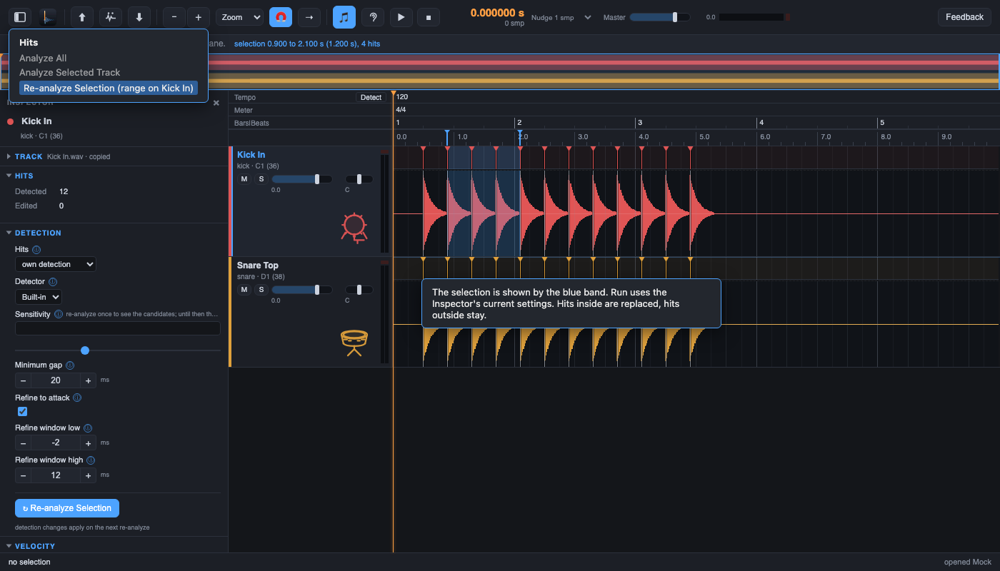
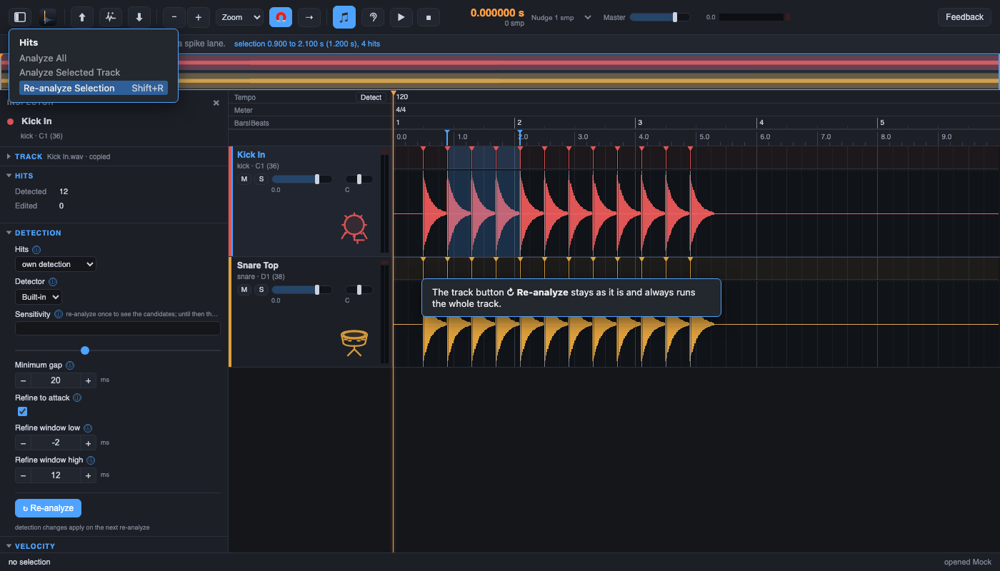
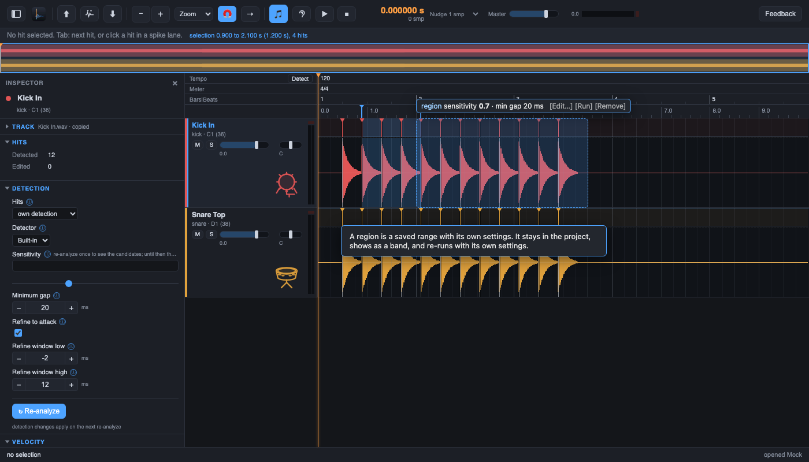
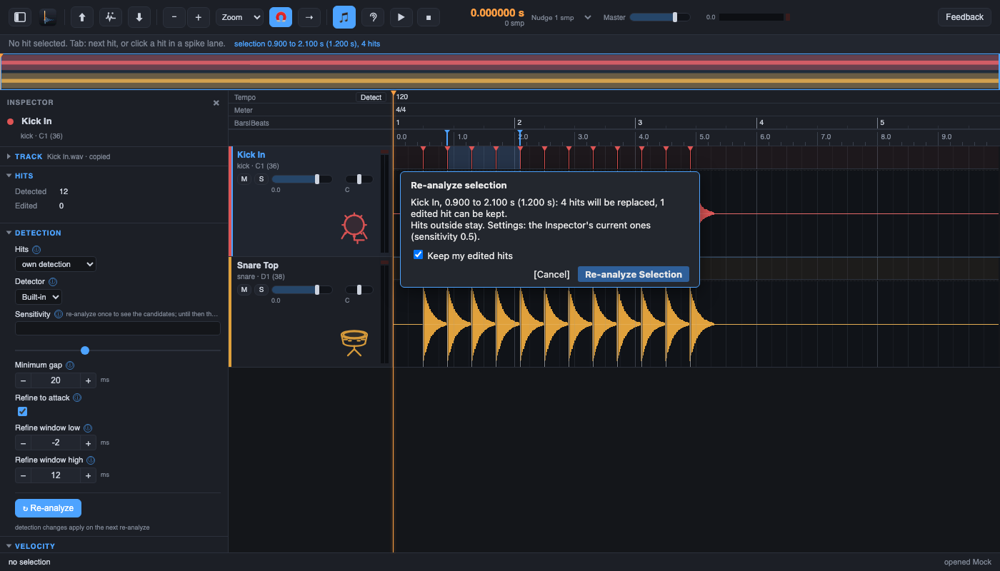
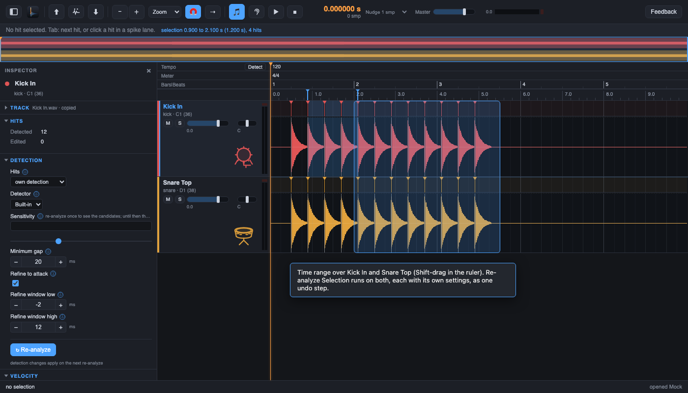

# Concept: re-analyze only a selected range (#243)

Status: options for the owner to choose from. No product code is part of this ticket; the chosen option
becomes a follow-up ticket.

## The wish

"I want to be able to re-analyze just a selection. We need to figure out the right UI/UX concept for that
that does not confuse or change the current concept too much."

## What exists today (the base to build on)

- A range selection on one track: a drag in the wave lane (`LN.sel`, one at a time, a blue band). Delete and
  the nudge keys act on every hit of the range as one undo step (#151). Learn This / Forget This (K,
  Shift+K) turn the range into a Learn mark. A click, K or Escape clears it.
- Re-analyze is per track: the Inspector button `Re-analyze`, Hits > Analyze Selected Track, the track
  context menu, and Analyze All. When a track holds edited hits (magenta), the Keep dialog asks whether
  they stay. The engine merges kept hits so that an edited hit wins within 20 ms over a picked one, writes a
  backup of the previous events, keeps the Learn marks of the track, and refreshes the follower tracks.
- The run uses the track's current settings (the Inspector values), also in the Keep case.

The range selection is the only "scope" concept the user already knows. Every option below reuses it; none
adds a second kind of selection except option C (a saved range).

## Rules that every option shares (the engine side)

These answer the edge questions once, so the options differ only in the interface.

1. Scope. The detector runs on the track with a pad of 100 ms on both sides (so the spectral frames and the
   refine-to-attack walk see their context). Only hits whose refined time lies inside `[t0, t1]` are taken.
2. Replaced and untouched. Hits of the track inside the range are replaced by the new ones. Hits outside are
   not touched at all (same times, ids, velocities).
3. Edges. A new hit is dropped when it is closer than the minimum gap to the nearest untouched hit outside
   the range. A hit outside is never moved by the run. So no double hit appears at an edge, and a hit that
   straddles the edge belongs to the side where its refined attack lies.
4. Edited and manual hits inside the range follow the Keep dialog as today (the dialog counts only the
   hits of the range). No edited hit in the range: no dialog, as today.
5. Learn marks and followers. Learn marks of the track stay (as in a whole-track run) and are applied to the
   new hits inside the range. Follower tracks refresh only for the range.
6. One undo step ("Re-analyze Selection") that restores the hits of the range, and the backup file of the
   previous events is written as for a whole-track run.
7. After the run. The info line says `Kick In: re-analyzed 0.900 to 2.100 s, 3 hits replaced by 4`. The
   export is the export of the track as it is: it has no notion of the run.
8. Several tracks. The range belongs to one track today. A run acts on that track only. Option E shows a
   range over several tracks.

## Option A: the existing Re-analyze acts on the range (like Delete does)

- Scope before running: the blue band is the scope. With a range, the Inspector button reads
  `Re-analyze Selection` (a tooltip names the range); the Hits menu item `Analyze Selected Track` becomes
  `Analyze Selection` while a range exists. No band: the old whole-track behaviour and labels.
- Settings: the Inspector's current ones.
- Everything else: the shared rules above. The Keep dialog opens with the text "in the range".
- For: nothing new to learn; it is the same rule as Delete and nudge (a range takes the key). One button.
- Risks: the label changes with a hidden state (a leftover range). A user who wants the whole track and has
  a stale band re-analyzes only a part, and the result looks like "it found nothing new". Mitigation: the
  button label and the band both change, and the info line names the range every time. Analyze All ignores
  the range (it stays whole-project).

## Option B: a separate command Hits > Re-analyze Selection

- Scope before running: the band; the menu item is enabled only with a range, and its text carries the
  range ("Re-analyze Selection (Kick In, 1.2 s)").
- Settings: the Inspector's current ones.
- The track button stays unchanged and always means the whole track, so nothing that exists changes meaning.
- Own key (proposal: Shift+R, free in the key map; the Cubase preset keeps its set).
- For: no hidden mode on the old button; the old workflow is untouched. Easy to explain in the guide.
- Risks: a second place for the same verb, found only in the menu and by key; a user looking at the
  Inspector does not see it. Mitigation: also add the item to the range context menu (right-click in the
  band, where Learn This already lives).

## Option C: a region that carries its own detection settings

- Scope before running: a saved band in the lane (dashed) with a small label (its sensitivity and
  minimum gap). The range is turned into a region by a command ("Make Region"), and then lives in the
  project until removed.
- Settings: the region's own (copied from the Inspector when made, then editable). This is the only option
  that detects one part of a track with other settings than the rest.
- Rules 1 to 7 above hold for each run of a region; Re-analyze of the whole track would respect the regions
  (it runs each with its own settings) or ignore them; the owner must choose (see the questions).
- For: it answers the real cause of a wish like this: a quiet or noisy part of a song that wants other
  settings. Reproducible: the settings are in the project.
- Risks: the largest change of the concept. Project format 1 must stay loadable (a new optional key), the
  Inspector no longer shows "the" settings of a track, and the whole-track run needs a rule for the regions.
  More states to explain. Not recommended as a first step; it can grow from A or B.

## Option D: a confirm dialog that shows the scope and the choices

- Scope before running: a small dialog opened from the range (context menu, Hits menu or key) that states
  the range, how many hits are replaced, how many edited hits exist, and which settings are used.
- Settings: shown in the dialog (the Inspector's, with a link to change them first); an optional "use
  more sensitive settings for this run" field is the only extra control.
- For: nothing is hidden: the user sees the scope, the count and the edit choice in one place, with the
  Keep checkbox inside the same dialog instead of a second one. Good as the dialog of A or B.
- Risks: one more dialog on a frequent action; the app avoids dialogs for routine edits (Delete has none).
  Better as the confirmation only when edited hits exist, or when more than N hits are replaced.

## Option E: a time range over several tracks (a ruler selection)

A ruler drag (for example Shift-drag) selects a time range for all tracks, or for the selected tracks.

- Scope before running: a band across the lanes of the chosen tracks.
- Settings: each track's own current settings (as in Analyze All).
- For: the common case "this verse was missed on kick and snare" is one action.
- Risks: today the selection is per track, and Delete and nudge, Learn and the follower rules all assume
  one track; a multi-track range changes those too. Needs the per-track rules of this document applied per
  track and one undo step for all of them. Larger than A and B.

## Comparison

| Question | A | B | C | D | E |
|---|---|---|---|---|---|
| Scope visible before the run | band + label | band + menu text | saved band + label | dialog text | band over lanes |
| Settings | Inspector | Inspector | region's own | Inspector (+ optional) | per track |
| Change to today's concept | small (a label) | none | large | small | medium |
| Risk of a wrong run | stale band | low | region forgotten | low | wrong tracks |
| Several tracks | no | no | no | no | yes |

## Recommendation

Start with option B plus the pre-run line of option D, and keep A open as a later shortcut:

1. Add `Hits > Re-analyze Selection` (enabled only with a range) with a key and an entry in the range
   context menu. The track's `Re-analyze` button stays whole-track. This changes no existing meaning and
   cannot cause a silent partial run.
2. Show the scope in the Keep dialog when it opens, and in the info line afterwards (rule 7). No new
   dialog when no edited hit is in the range.
3. Option A is attractive but makes one control mean two things by an invisible state; take it only if
   users ask for the button after B has been used for a while.
4. Options C and E answer different needs (settings per part; many tracks). Keep them as separate
   tickets once the owner wants them.

Risks of confusing the current concept, for the recommendation: the user may expect the whole-track button
to honour the band. The tooltip of the button already says "this track"; the menu text of B says "Selection".

## Questions for the owner

1. Which option (or combination) do we build first?
2. Option C only: does a whole-track run use the regions' settings, or ignore them?
3. Should Analyze All ever honour a range? (This document says no.)
4. The key for B: Shift+R, or none (menu and context menu only)?

## Decision

Not yet made. The owner's choice is recorded here before the implementation ticket is written.

## How the mockups were made

The screenshots are the real editor page against the test bridge with a scratch project (synthetic audio, two
tracks, a range selected on one track). The label, the menu and the dialog are drawn over the page as
overlays; they show the proposal, not shipped code.
