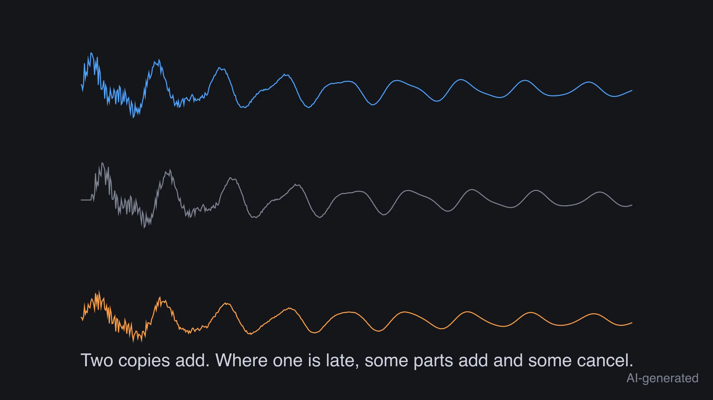
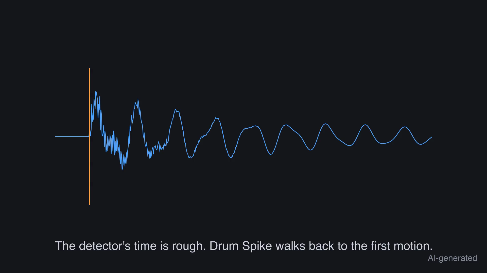

# 1. Why sample-exact matters

A trigger or a sample replacer fires a new sound for every drum hit in a close-mic track. If it
fires late, the new sound smears the original. One millisecond of delay is enough: the close mic
and the triggered sound filter each other, and the attack loses its punch.

## What goes wrong without it

DAW transient detectors work on loudness. They fire on a wrong sample, or they fire twice on one
hit, or they fire on another drum that leaks into the mic. Every one of these is audible.

## What Drum Spike does

Drum Spike finds every drum hit in a close-mic track. It puts one MIDI note and one spike on the
first sample of the attack of the hit. It does this per drum track, so a snare mic yields snare
hits and nothing else.

Next: [bring in a session](02-add-tracks.md).
