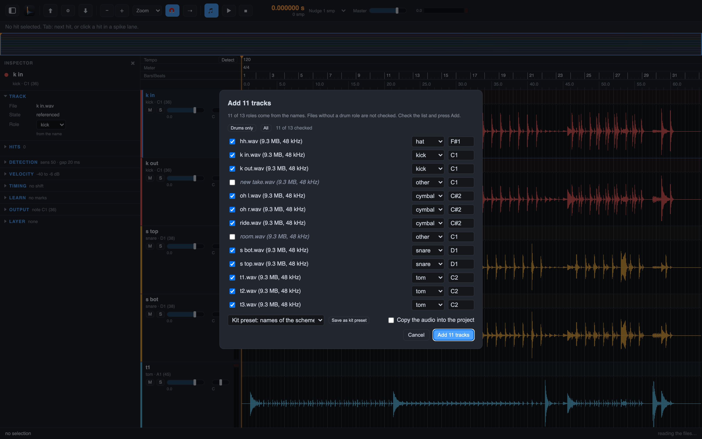
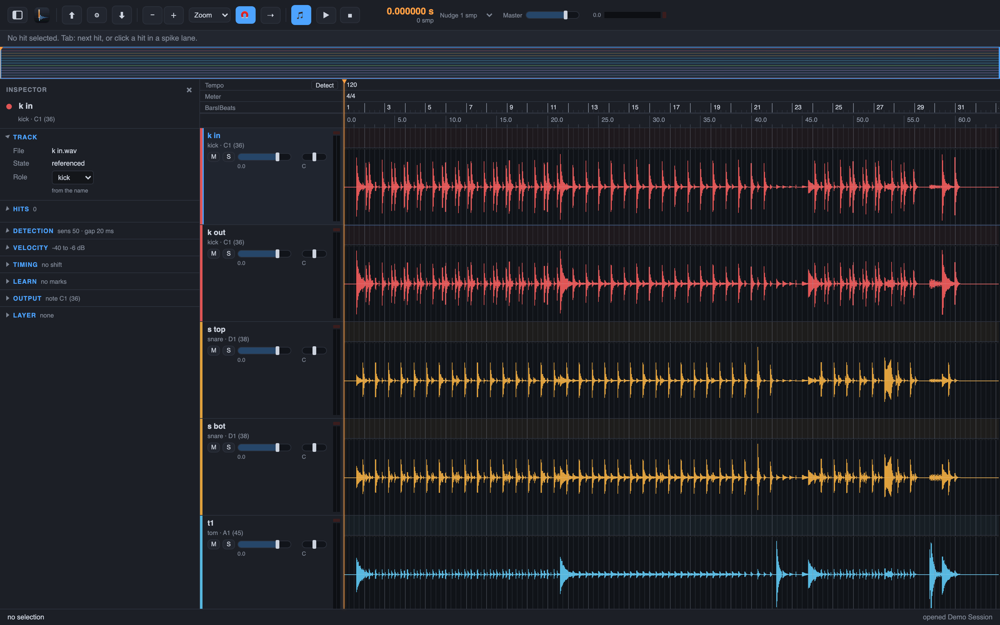

# 2. Bring in a session

Drum Spike reads your existing audio. The files stay where they are. Drum Spike references them
and keeps the BWF time stamps, so your DAW session and the project stay in sync.

## Steps

1. **File > New Project…** (`Cmd+N`).
2. **File > Add Tracks…** (`Shift+Cmd+I`).
3. Pick WAV files, or pick a session folder such as a Pro Tools "Audio Files" folder.
4. Drum Spike gives each track a role: kick, snare, tom, hat, cymbal or other. The role comes
   from a kit preset, or from the file name. A file name like "k in", "s top" or "t1" says the
   role directly. Drum Spike never offers its own exports as drum tracks.
5. Check the roles. To change one, open the Inspector with **View > Show Inspector** (`Option+I`),
   section Track. The hint there says where the role came from. A change analyzes the track again.
   **Edit > Undo** (`Cmd+Z`) brings everything back.

## Start screen and recent projects

At launch, a splash shows for about 5 s; a click or any key ends it early. The start screen then
lists your recent projects; a click opens one. **Clear Recent** under the list, or the Clear Recent
entry at the end of the File menu's recent projects, empties the list. The projects themselves stay on disk.

## Which tracks to load

Load every close mic: the kick, snare, tom and hi-hat mics are the tracks
you trigger, and each one is a bleed source for the others. Overheads, ride
and crash help the rules as sources too. Room mics and sample tracks usually
stay out. See [Get the best results](best-results.md) for the full list and
the reasons.

The demo session has 13 tracks and 62.5 s of audio. It is the example for the rest of the guide.

Next: [detection](03-detection.md).
