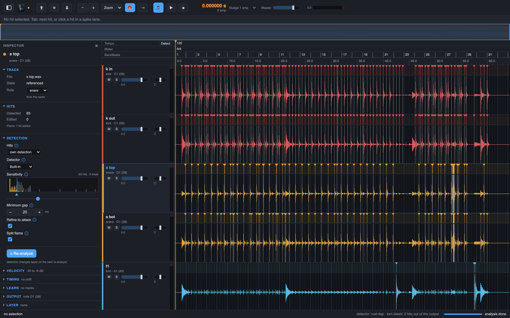

# 3. Detection

Drum Spike finds the hits for you. The analysis runs per track when you add tracks, and the
detector listens for the role of the track only. A snare mic yields snare hits, not the hi-hat
that leaks into it.

## How it works

The detector looks for a sudden rise of energy in the bands of the drum itself. Gates then keep
the real hits: the level, the shape of the hit against the loud hits of the track, and the
attack in the time domain. Cross-mic rules decide the rest. A hit is loudest and earliest on its
own mic, and the overhead mics deny hi-hat and cymbal bleed.

## Steps

1. Add tracks. The analysis runs on its own.
2. To run it again, use **Hits > Analyze Selected Track** or **Hits > Analyze All**.
3. Only a part of a track: select a range in the wave lane and use **Hits > Re-analyze Selection**
   (`Shift+R`, also in the range context menu). The hits of the range are replaced, the hits
   outside keep their times, ids and velocities, and a new hit that would sit closer than the
   minimum gap to an outside hit is dropped. Edited hits in the range ask with the Keep dialog
   (it names the range); the run is one undo step and writes the backup of the previous events.
   The Inspector's Re-analyze button and Analyze Selected Track stay whole-track.
4. The Sensitivity setting re-picks the hits from the kept candidate list. It does not run a new
   analysis, so it is fast and undoable.

The demo session holds 309 hits. Chapter 4 shows where each one lands.

Next: [sample-exact](04-first-sample.md).
