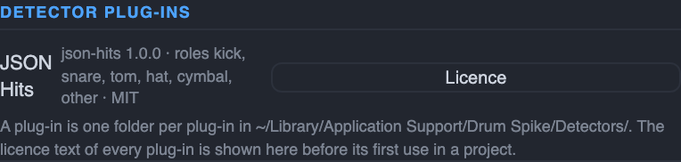
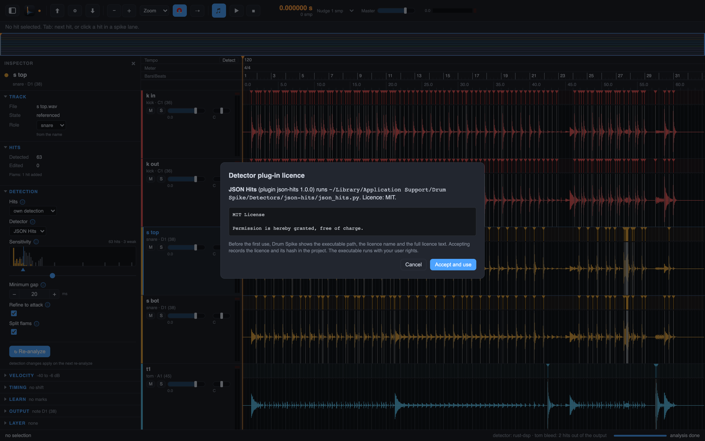

# 3b. Detector plug-ins

Chapter 3 is the built-in detector: it is always there and stays the default. A detector
plug-in is an outside program that finds the hits of a track instead. Drum Spike keeps the
rest: the plug-in proposes the hit times, and Drum Spike puts each hit on the first sample
of its attack (chapter 4), sets the velocities and writes the exports, exactly as with its
own detector.

## Install a plug-in

A plug-in is one folder per plug-in, copied by hand into
`~/Library/Application Support/Drum Spike/Detectors/`. The folder name is the plug-in's id
and holds the manifest `manifest.json`, the executable and the licence file. Drum Spike
never downloads a plug-in.

The manifest names the id, the name the app shows, the version, the roles the plug-in
supports (kick, snare, tom, hat, cymbal, other), the sample rates it accepts, the licence
and the executable. A folder without a valid manifest or executable stays invisible.

To see what is installed, open **Drum Spike > Settings…** and scroll to the Detector
plug-ins group. Each entry shows the id, the version, the roles, the licence and a
Licence button.



## The licence dialog

Before a plug-in runs the first time in a project, Drum Spike shows a dialog with the
plug-in's name, the executable path, the licence name and the full licence text. The
executable runs with your user rights, so read the path before you accept. **Accept and
use** records the licence and its hash in the project; Cancel leaves the detector
unchanged. The licence of an installed plug-in stays readable under the Licence button in
Settings.



## Choose the detector

Select a track and open the Inspector, section Detection (chapter 3). The Detector select
lists Built-in first, then one entry per installed plug-in that supports the track's role
and sample rate. The choice applies on the next analyze, like the other detection
settings. A plug-in's hits do not come from the Sensitivity slider; the slider judges the
built-in detector's candidates only, and the app says so under the select. A follower
track has no Detector select, because it has no detection of its own.

If the sample rate of the track is not in the plug-in's list, Drum Spike resamples the
track for the plug-in. The hit times are in seconds, so nothing else changes.

## When a plug-in is missing

A project that names a plug-in that is not installed opens normally and shows its stored
hits. A new analyze of that track asks first: install the plug-in again (copy its folder
back and reopen the project) or analyze the track with the built-in detector now. A
plug-in that crashes or answers badly fails its track with a readable error; the other
tracks and the app continue.

## Command line and agent API

The analyze command of the agent API (chapter 14) takes `--detector <id>`:

```bash
drumspike analyze_start --project ~/Song --detector json-hits
```

`builtin` or a missing flag runs the built-in detector; a track's own `params.detector`
wins over the flag. The same `detector` argument is on the MCP `analyze_start` tool. On
the command line there is no dialog: the first use of a plug-in records its licence in
the project, the same record the dialog writes.

Drum Spike is free and open source (Apache-2.0). A plug-in comes from its maker with its
own licence, which the dialog above shows.

Next: [sample-exact](04-first-sample.md).
