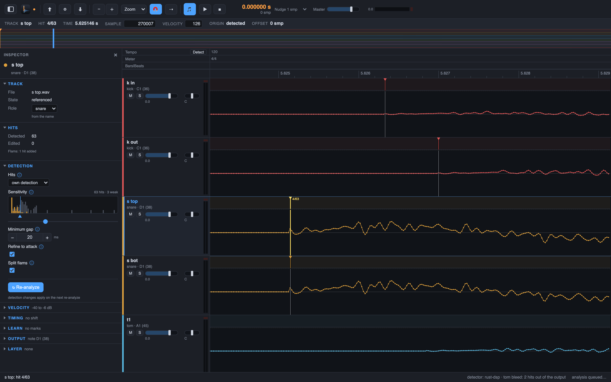

# 4. Sample-exact

This is the core of the product. Detection says "a hit is near here". Drum Spike then walks to
the first motion of the attack in the waveform and puts the hit on that sample. Your triggered
sound starts on the same sample as the drum on the close mic.

## Steps

1. Zoom to **View > Zoom Presets > 5 ms** (key `6`) to see it.
2. Click a hit. The hit line sits on the first motion of the attack, not on the loudest point.
3. Move between hits with the Next Hit and Previous Hit keys to spot-check a few. Chapter 9
   (coming) takes you to the doubtful ones first.

Nothing to adjust here in the normal case. The sample-exact position is the default, not an
option you have to find.

Next: [export](05-export.md).
