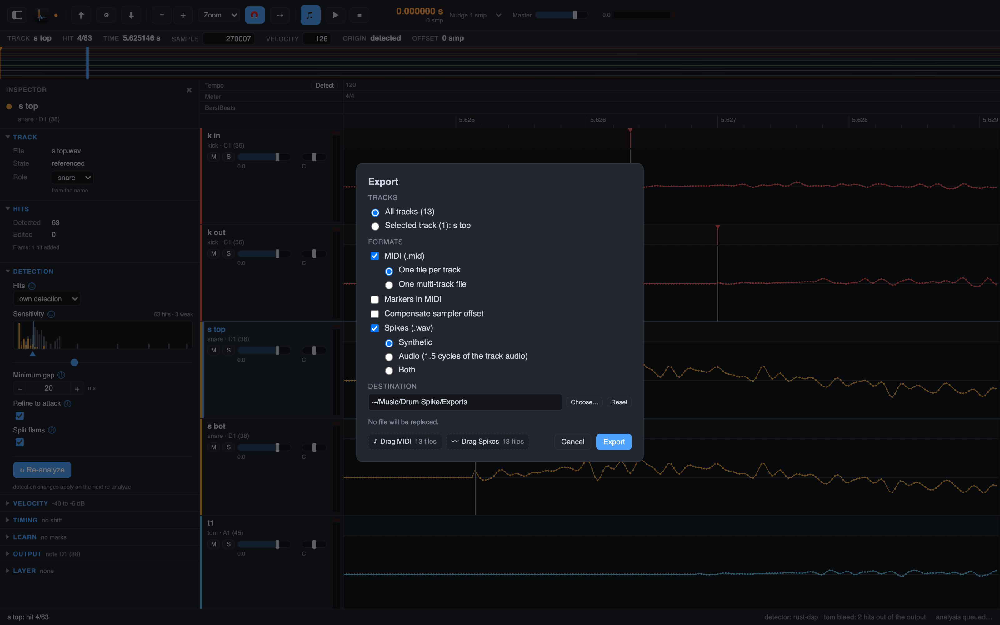
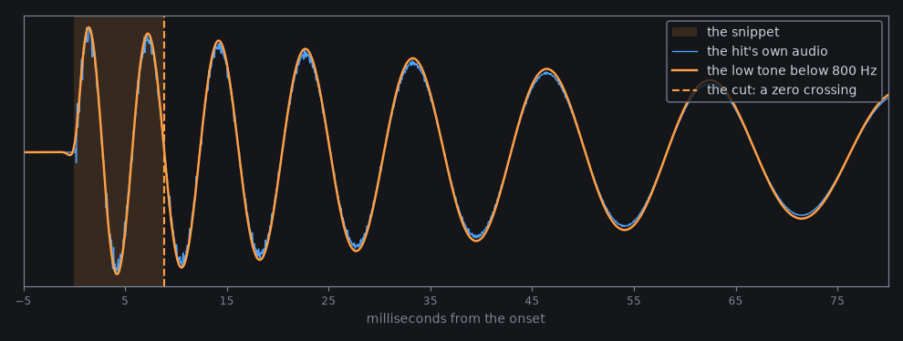

# 5. Export

Export writes the hits as MIDI and spike files for your DAW. The files carry the time of the
session, so they line up in Pro Tools. After this chapter the main job is done: tracks in, hits
found, files out.

## Steps

1. **File > Export…** (`Cmd+E`). The Export dialog opens.
2. Choose per track a MIDI file and a spike WAV, or one multi-track MIDI file for all tracks.
3. Choose the spike type:
   - Synthetic: a short click.
   - Audio: the hit's own audio from the onset over its body. Drum Spike low-passes the track
     below 800 Hz and follows the first three clear swings of that low tone (a swing counts at
     25 % of the largest of the first three). The snippet ends on a zero crossing, at most
     60 ms. A kick gives about 15 to 25 ms, a snare about 5 to 10 ms.
   - Both: a synthetic spike and an audio spike.
4. Pick the destination folder and export.
5. **File > Export Again** (`Option+Cmd+E`) repeats the last export with the same settings. This
   is handy after an edit: export again and the DAW gets the new files.

this demo kick: 8.9 ms (the length the Audio Spike rule measures on this hit). Real kicks
usually land at 15 to 25 ms, snares at 5 to 10 ms.

The Audio Spike in numbers: Drum Spike copies the hit's own audio from the onset over its
body. The low tone below 800 Hz drives the length: the first three clear swings of that tone,
cut at the zero crossing, at most 60 ms. A kick lands around 15 to 25 ms, a snare around 5 to
10 ms. The click spike stays available: it is the synthetic option in the same dialog.

Next: [find your way](06-find-your-way.md), the first chapter of part 2.
