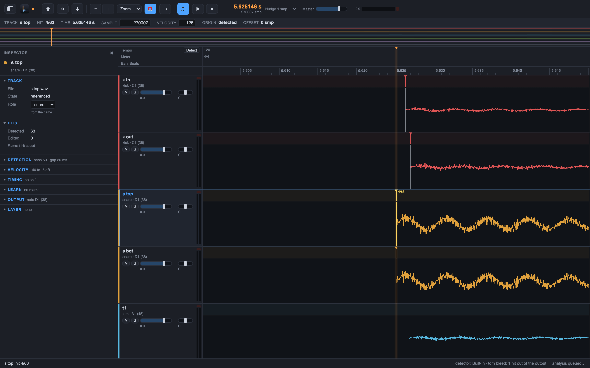

# 6. Find your way: play, zoom, move between hits

You have hits (chapters 2 to 4) and files (chapter 5). Now you check them by ear and by eye.
Drum Spike moves like a DAW: play, zoom, and jump from hit to hit. The demo session holds 309
hits over 62.5 s; these keys take you through them fast.

## Steps

1. Press Space. **Transport > Play/Stop** plays from the playhead; press Space again to stop.
   `Option+Space` is play-and-return: the next press of `Option+Space` or Space stops and puts
   the playhead back where the play started. The keys reach the app from anywhere: after a
   click on a button or a slider (the Sensitivity slider of a histogram, for example) Space
   still plays. Only a text field keeps its keys, and the status line tells you when a
   transport key went into one. While the computer is busy (a large build, for example), the
   playhead keeps moving smoothly: frames drawn between two clock updates no longer lose the
   playhead. **Transport > Stop Returns to Start** (`I`) is a mode like
   Suspend Follow when Editing: while it is checked, a Stop (Space while playing, or the ■
   button) puts the playhead back where the play started, exactly like `Option+Space`; the
   setting survives a restart.
2. Press `Shift+Space` for **Transport > Half-Speed Play**: half speed, one octave down. This
   is the setting for a close check of an attack.
3. Zoom with the number keys. The six presets of **View > Zoom Presets > Full** (`1`), **30 s**
   (`2`), **5 s** (`3`), **500 ms** (`4`), **50 ms** (`5`) and **5 ms** (`6`) set the span of the
   lanes. **View > Zoom In** (`T`) and **View > Zoom Out** (`R`) zoom around the playhead.
4. Change the track height with `Option+Up` and `Option+Down`
   (**View > Track Height > Shorter**, **Taller**), or set it directly with `Option+Cmd+1`,
   `Option+Cmd+2` and `Option+Cmd+3` (Small, Medium, Large). Drag the lower border of a
   track row or of its header to give one track its own height; a double-click on the
   border puts it back.
5. The lane toggles: **View > Velocity Lane** (`V`), **View > Other Mics Under Hit** (`O`),
   **View > Bars|Beats Ruler** (`Shift+B`) and **View > Markers Ruler** (`Shift+R`).
6. Step through the hits. **Hits > Next Hit** (`Tab`) and **Hits > Previous Hit** (`L`) move on
   the selected track; with no track selected, they move on all tracks.
   **Hits > Next Hit on All Tracks** (`N`) always moves on all tracks.
7. Press `Option+O` for **View > Show Overview**: the whole session in one strip over the lanes.
   Click it to move fast over a long session.
8. Press `M` for **Edit > Set Marker at Selection** to drop a marker at the selected hit or at
   the playhead. **Transport > Next Marker** (`Option+M`) comes back to it later.

The keys of this chapter are the Pro Tools preset, the default. Drum Spike also has a Cubase
preset: **Drum Spike > Settings…** (`Cmd+,`) switches. **Help > Keyboard Shortcuts** lists all
keys of the current preset. **Help > About Drum Spike** shows the Cherry Blossom Valley logo,
the licence line and links to the website and the source code.

Next: [edit hits](07-edit-hits.md).
