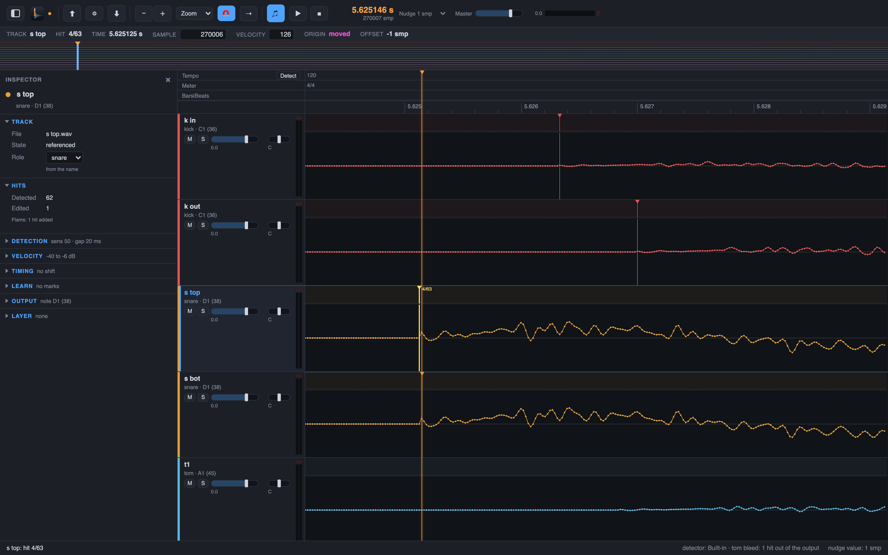

# 7. Edit hits

The detector is right almost always. When it is not, you fix the hit list by hand: add a hit,
delete a hit, or move a hit by samples. Every edit is undoable, and the exports follow.

## Steps

1. Put the playhead where the hit is missing and press `H` for **Edit > Add Hit at Playhead**.
   The new hit sits on the playhead, on the selected track.
2. Select a hit and press Delete or Backspace for **Edit > Delete Hit**. Or right-click the hit.
3. Select a hit and press `Left` or `Right` for **Edit > Nudge Hit Earlier** and **Nudge Hit
   Later**. The step is the nudge value: the list **Edit > Nudge Value > 1 Sample** holds `1
   Sample`, `10 Samples`, `100 Samples`, `1 ms` and `10 ms`. One sample is the smallest step;
   the exports carry it.
4. Press `A` for **Hits > Audition Hit**: the selected hit plays on its track alone, from 30 ms
   before to 250 ms after the hit. This is how you check a nudge.
5. Undo with **Edit > Undo** (`Cmd+Z`), redo with `Shift+Cmd+Z`. **Edit > Undo History…**
   (`Option+Cmd+Z`) lists the steps; a click goes back to that step.

Edits stay edits: Drum Spike never changes your audio. Export again after an edit and the DAW
gets the new files (chapter 5).

Next: [velocity](08-velocity.md).
