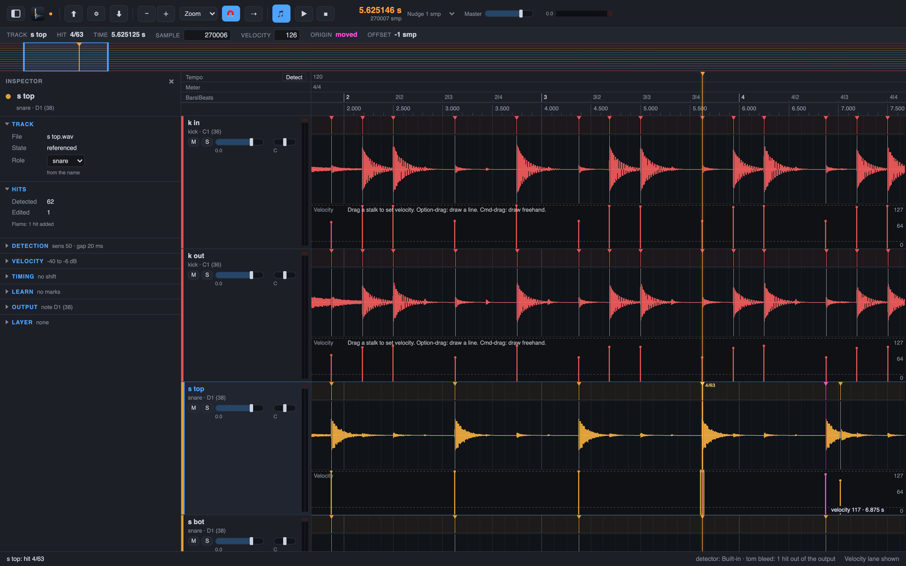

# 8. Velocity: how hard each hit was played

Every hit gets a velocity from the level of its attack: a hard stroke plays loud, a ghost note
plays soft. The velocities go into the MIDI files, so your DAW plays the dynamics of the
session. You shape them in the velocity lane.

## Steps

1. Press `V` for **View > Velocity Lane**. A lane under the wave lanes draws one stalk per hit;
   the height of a stalk is its velocity, 0 at the bottom and 127 at the top.
2. Drag a stalk to set one velocity. Drag over a range to draw a line across the hits:
   `Option`-drag draws a straight line, `Cmd`-drag draws freehand. One drag is one undo step.
3. Drag the top border of the lane to resize it.
4. Shape the whole track in the Inspector. The velocity floor and ceiling set the range: a hit
   at or above the ceiling gets velocity 127. The Loudness cut leaves out hits whose peak is
   below its level, for example quiet bleed. They show grey and stay in the project, but MIDI
   and spikes leave them out. An empty field means no cut.
5. After a floor, ceiling or cut: **Edit > Recompute Velocities** builds the curve again from
   the levels of the hits.

For why a velocity is what it is, see the 3b1b explainer "From waveform to velocity" (coming).

Next: [doubtful hits first](09-doubtful-hits.md).
