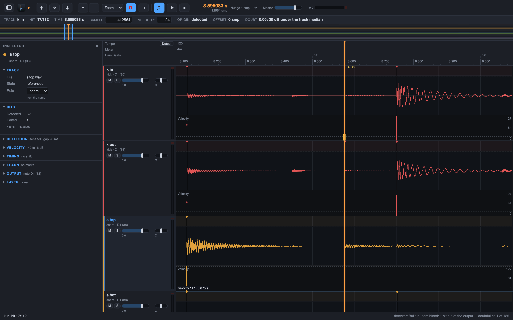

# 9. Doubtful hits first

After the analysis, some hits are less sure than others: a quiet hit, a hit a rule added. The
review queue puts these in front of you, so you check the doubtful hits before you export.

The app gives every hit a confidence from 0 to 1. It comes from the level of the hit against
the median of its track: a hit as loud as the median gets 1, a hit 24 dB under the median
gets 0. A hit that you added or moved keeps confidence 1, and a hit that is grey does not
count. A hit under 0.5 is doubtful.

## Steps

1. Press `D` for **Hits > Next Doubtful Hit**. The queue holds the doubtful hits of all
   tracks, lowest confidence first. The playhead jumps to the first one and the app selects
   it. The status line says which doubtful hit you are on, for example
   `doubtful hit 3 of 17`.
2. Press `Shift+D` for **Hits > Previous Doubtful Hit** to step back. With no doubtful hit
   left, the status line says `no more doubtful hits`.
3. Read the info line under the toolbar, above the lanes: the Doubt field says the confidence of the hit and the
   reasons, for example `0.25: 18 dB under the track median`. A hit that the level gate alone
   would have refused names the rescue that kept it, for example `soft gate: ghost note below
   the level gate`, `shape rescue below the level gate` or `weak flux, kept by the time-domain
   attack`. This tells you what to check.
4. Check the hit: press `A` for **Hits > Audition Hit**, and look at the attack in the lane
   (chapter 4). A doubtful hit that is a real hit stays as it is; one that is not, you delete
   with Delete, or nudge with `Left` and `Right` (chapter 7). Edit the hit and its
   confidence no longer matters: your edit decides.
5. When the queue is empty, the status line says `no doubtful hits`. Export as in chapter 5.

The review queue only points at hits. It never changes the detection, and a hit you do not
touch keeps its place in the exports.

Next: [bleed and the hard cases](10-bleed.md).
