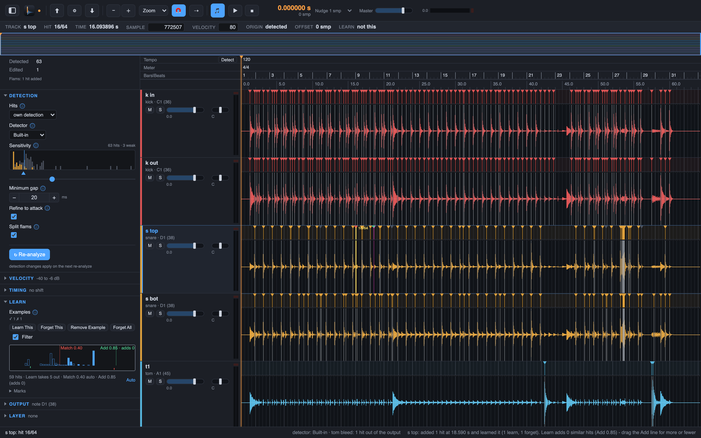

# 11. Learn: teach by example

The rules of chapter 10 clean the whole session on their own, and the Sensitivity slider of
chapter 3 tunes a whole track. Learn is for the hits that are still wrong after that: the
ghost note the rules keep, the bleed they missed, the hit the detection never found. You
mark a few hits by hand, and the track learns from them.

Two directions:

- **Forget This** (`Shift+K`) removes the marked hit and its near copies. This is for
  bleed the rules missed and for ghost notes you do not want.
- **Learn This** (`K`) marks a good example. On a hit the detection missed, it adds the
  hit, and from then on the track brings in the missed hits that look like it.

Both kinds of marks are kept in the project, up to 64 of each kind per track. A follower
track (chapter 12) has no marks of its own: a mark on it goes to its source track.

## Steps

1. Select what to teach: drag over a stretch of the wave lane (`Escape` clears the
   selection), or just click a hit. Then press `K` for **Hits > Learn This** or `Shift+K`
   for **Hits > Forget This**. A range takes its hits. Where the detection has no hit, the
   strongest candidate of the range is taken, and if there is none, the strongest rise of
   6 dB or more: a ghost note that sits under the Sensitivity threshold is found too. The
   status line says what the step did, for example `Learn This on 3 hits (2 learn, 1
   forget)`.
2. The first Forget This turns the Learn filter on: **Hits > Learn Filter** in the menu is
   a check item, and from then on the track filters on every analysis. A hit the filter
   takes out goes grey at once, like a bleed hit: it stays in the lane, `Tab` skips it, and
   it leaves the MIDI, the spikes and the click. The velocity lane shows its stalk grey.
3. Forget This alone is careful: it takes only the marked hit and its near copies. Once
   you have also marked a Learn This example, the filter knows the difference between the
   hits you want and the ones you do not, and the same Forget This takes the similar
   bleed as well. The near-marks gate applies only while the track has no Learn This
   examples, and the example scores feed the filter. Add a Learn This example when a
   Forget This does not reach far enough.
4. Open the Inspector and the Learn section. The Similarity histogram shows every
   candidate of the track against your examples, with two draggable lines: **Match**, the
   strictness of the filter (drag it for more or fewer hits out), and **Add**, the line of
   the rule below. The line under the histogram says the counts: the hits, how many the
   Learn takes out, and the current Match.

5. Learn This on a hit the detection missed adds the hit at once, flagged as learned, and
   stores the example. From then on the Add rule brings in the candidates that sit below
   the Sensitivity but look like the example; a Forget example or an existing hit nearby
   keeps a candidate out. The added hits run through the same analysis as every hit and
   play in the exports like any hit. Learn This never removes a detected hit and never
   turns the filter on.
6. When one step adds a lot at once, more than 10 hits or a quarter of the track's hits, a
   dialog asks Keep or Undo, so a wrong example cannot flood the track.
7. To take an example back, select its hit or mark and press `Option+K` for **Hits >
   Remove Example**; nothing there changes nothing. **Hits > Forget Examples of Track**
   removes every mark of the track. Right-click a mark bar to change its kind. Every
   Learn step is one undo step (chapter 7).

Next: [follower tracks and layers](12-followers-and-layers.md).
