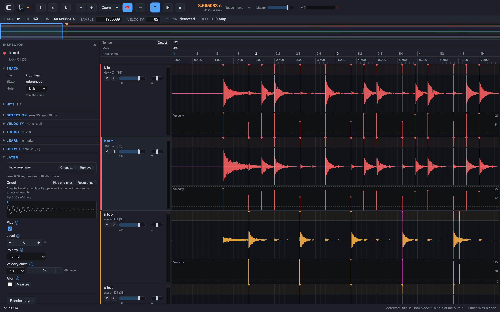

# 13. Tempo, bars and beats

Drum Spike knows the tempo of your session. From the kick and snare hits it builds a tempo
and meter map, and with the map come the bars and beats: a grid in the lanes, rulers over
the lanes, and a metronome. The MIDI exports carry the map, so your DAW sees the same bars.

## Steps

1. Analyse the kick and snare tracks first (**Hits > Analyze All**): the detection reads the
   hits of these tracks to find the beat.
2. Select **Track > Detect Tempo…**. The dialog shows the start tempo in whole BPM with
   its confidence and the other tempos it could be (half, double, 3/2), the position of bar 1,
   the meter, and the tempo steps with their bars. A tempo step is a place where the song
   changes speed. If the confidence of bar 1 is low, the dialog offers the other candidate
   (two beats later in 4/4); try it. **Accept** sets the map as one undo step. An octave
   error, half or double, is the usual fault: check the tempo by ear.
3. Put bar 1 right: select **Track > Set Bar 1 at Playhead**, or select a hit first and the
   command moves bar 1 to it. **Track > Set Bar 1 at Audio Start** puts bar 1 at 0 s, the DAW
   convention (in Pro Tools the session start is bar 1). You can also drag the bar-1 marker of
   the Bars|Beats ruler, or double-click it to type the time. The tempo, the steps and the
   meter stay; each of these is one undo step.
4. Your DAW knows the tempo already? **File > Import Tempo Map…** reads a MIDI file from
   the DAW and takes its tempo and time-signature events as the map. One undo step.
5. Press `G` for **View > Show Bar and Beat Grid**: light bar and beat lines in the lanes,
   under the hit lines. A beat wider than 24 px also gets its 8th line, and above 48 px its 16th lines (fainter). There is no snap; the grid is a guide, not a fence.
6. The rulers sit over the time ruler. **View > Tempo Ruler** shows the tempo steps:
   double-click adds one, double-click a value edits it, `Delete` removes the selected one.
   Type the right start tempo over a wrong one (for example 92 over a detected 46) and bar 1
   moves onto the beat that the kick and snare hits support; the status line says where it
   moved, and one undo restores both. A map with tempo steps keeps its bar 1.
   **View > Meter Ruler** shows the meter changes the same way. **View > Bars|Beats Ruler**
   shows bar numbers and beat ticks; a click puts the playhead there.
7. Press `C` for **Transport > Metronome Click** and play: the click sounds at the hits of
   the tracks, each with the pitch of its role.

The map is part of the project, so it saves with it and the exports use it (chapter 5).

Next: [automate it](14-automate.md).
